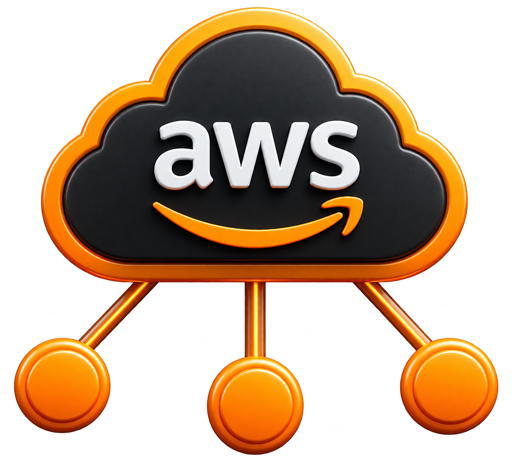

<p align="center">
  
</p>

<h1 align="center">AWS Visualizer</h1>

<p align="center">
  A native macOS app for browsing and working with your AWS accounts.<br>
  <b>Pre-release 0.9.2</b> · macOS 14+
</p>

> **Runs entirely on your Mac.** AWS Visualizer is a SwiftUI app plus a small
> Node.js service that runs on your own computer and talks to AWS with the AWS
> SDK for JavaScript. There is no server, no account to create, and no
> telemetry: nothing leaves your Mac except your own requests to AWS.

---

## Contents

- [Requirements](#requirements)
- [Install and run](#install-and-run)
- [First launch](#first-launch)
- [Update](#update)
- [Uninstall](#uninstall)
- [Where your data lives](#where-your-data-lives)
- [Troubleshooting](#troubleshooting)
- [Status and license](#status-and-license)

---

## Requirements

| | |
|-|-|
| **macOS 14 (Sonoma) or later** | The app is macOS only for now. |
| **Xcode or the Command Line Tools** (Swift 5.9+) | The app is built on your Mac. Install the tools with `xcode-select --install`. |
| **Node.js 20+ and npm 9+** (22 LTS recommended) | Runs the local API. If you don't have it, the app offers to install Node.js 22 into its own folder on first launch (no admin password; other Node installs are left alone). |
| **AWS CLI v2** | Used for sign-in. Version 2.32+ for personal accounts with `aws login`. [Install the AWS CLI](https://aws.amazon.com/cli/). |
| **git** | To clone this repository. Comes with the Command Line Tools. |
| **AWS access** | An IAM Identity Center portal URL (`https://<name>.awsapps.com/start`), or a personal AWS account. |

Check what you have:

```bash
sw_vers -productVersion
```

```bash
swift --version
```

```bash
node --version
```

```bash
aws --version
```

---

## Install and run

**1. Clone the repository**

```bash
git clone https://github.com/farukboyraz/AWSVisualizer.git
```

```bash
cd AWSVisualizer
```

**2. Build and open the app**

```bash
npm run mac
```

This checks your tools, builds the app (release), assembles
`dist/mac/AWS Visualizer.app`, signs it for your Mac and opens it. The first
build takes a few minutes; later ones are faster.

- **No `npm install` needed.** On first launch the app installs the packages
  it needs (`npm install --omit=dev`), and the AWS SDK package of each service
  when you pick your services.
- **Keep the folder where it is.** The app runs its local API from this
  folder's `packages/api`. To start the app quickly later, keep it in the Dock
  (right-click › Options › Keep in Dock) or run `npm run mac` again. If you
  move the app somewhere else, set `AWSVIS_API_DIR` to this folder's
  `packages/api`.
- **It only runs on the Mac that built it.** The app is signed ad hoc (no Apple
  developer account), so copying the `.app` to another Mac won't work: clone
  and build there instead.
- A faster debug build: `npm run mac:debug`.

---

## First launch

1. **Node.js check.** If Node.js or npm is missing or too old, install
   Node.js 22 LTS with one click (downloaded from nodejs.org) or keep using
   yours.
2. **Core packages.** If they're missing, `npm install --omit=dev` runs with
   live output.
3. **Local API** starts on `127.0.0.1:9000`. It only accepts requests from the
   app itself.
4. **Your AWS access portal.** Enter its start URL and region, or pick one
   that is already in `~/.aws/config`. The app adds an `[sso-session]` block to
   `~/.aws/config`, the same one `aws configure sso` writes. You can also add a
   personal account here.
5. **Settings file.** The app asks before creating `~/.awsvisualizer`. If you
   say no, settings last for that session only.
6. **Sign in.** `aws sso login` opens your browser. The sign-in is shared with
   the terminal: afterwards `aws … --profile <name>` works there too.
7. **Profiles.** If you have no profiles yet, the app lists the accounts and
   roles you can use and lets you name a profile for each.
8. **Default services.** Pick the services you use; the app installs their AWS
   SDK packages and shows the progress.

---

## Update

```bash
git pull
```

```bash
npm run mac
```

The app checks its packages again on launch. **Settings › About** shows the
app and local API versions; if they differ, an old local API is still running
and restarting the app fixes it.

---

## Uninstall

1. Quit the app.
2. Delete the cloned folder (the app is inside it, in `dist/mac`).
3. Delete `~/Library/Application Support/AWSVisualizer` and `~/.awsvisualizer`.

Your `~/.aws` files belong to the AWS CLI; leave them unless you also want to
remove those profiles.

---

## Where your data lives

| Path | What |
|------|------|
| `~/.awsvisualizer` | Your settings: portals, selected and favorite services, display, dashboard sections and cards. Plain JSON. |
| `~/.aws/config`, `~/.aws/credentials`, `~/.aws/sso/cache` | AWS's own files, shared with the AWS CLI. The app writes here only when you add a portal, a profile or a personal account. |
| `~/Library/Application Support/AWSVisualizer/` | `modules/`: AWS SDK packages for your services. `node/`: Node.js, if the app installed it. |
| `$TMPDIR/awsvisualizer-api.log` | Local API log (**Settings › About** opens it). |
| `dist/mac/AWS Visualizer.app` | The built app, inside the cloned folder. |

---

## Troubleshooting

| Problem | What to do |
|---------|-----------|
| "Swift is missing" | Run `xcode-select --install`, then `npm run mac` again. |
| "The AWS CLI (v2) wasn't found" | Install it from [aws.amazon.com/cli](https://aws.amazon.com/cli/), then press *Retry*. |
| "Port 9000 is used by another program" | The local API needs port 9000 (MinIO, Portainer and others use it too). Quit that program and retry; the app never stops programs that aren't its own. |
| "The local API service could not be started" | Check **Settings › Node.js & Packages**, or the log at `$TMPDIR/awsvisualizer-api.log`. |
| A service says a package is missing | Press *Install* on that screen, or use **Settings › Node.js & Packages**. |
| Sign-in expired | Press *Log in* in **Settings › Platforms & Accounts**, or run `aws sso login` in a terminal. |
| The app can't find `packages/api` | You moved the app. Run it from `dist/mac`, or set `AWSVIS_API_DIR`. |
| macOS says the app can't be opened | Build it on this Mac with `npm run mac`; an app built on another Mac won't open here. |

---

## Status and license

This is a **pre-release**. Features and settings may still change before 1.0.

**All rights reserved.** The source is public so you can read it, build it and
run it on your own Mac. It doesn't come with a license to copy, modify or
redistribute it.

The software is provided **as is**, without warranty of any kind. It acts on
your real AWS resources with your own credentials, so review what an action
does before you confirm it.

Pull requests are welcome, but only the maintainer merges changes.

*AWS and the AWS logo are trademarks of Amazon.com, Inc. or its affiliates.
This project is not affiliated with or endorsed by Amazon Web Services.*
